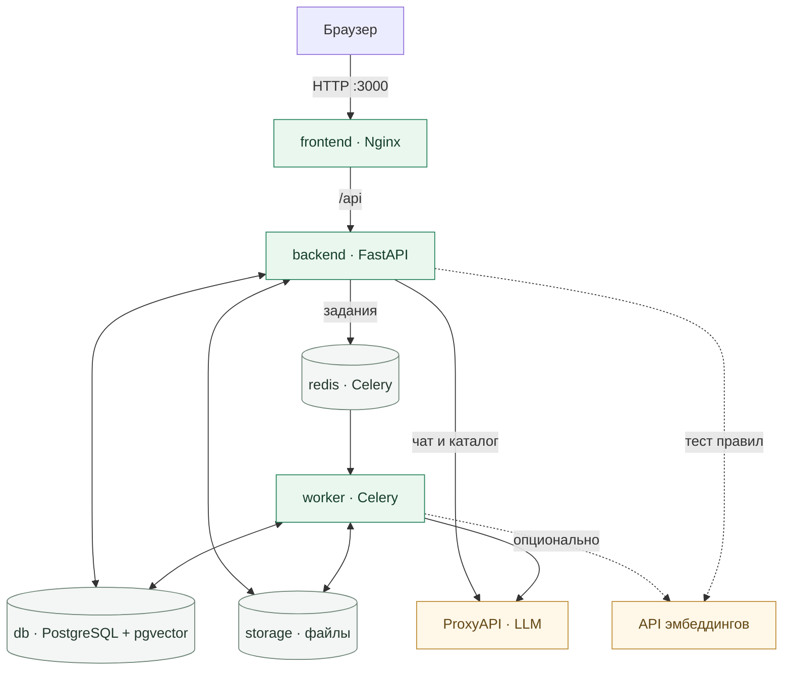

<p align="center">
  
</p>

<h1 align="center">AntiRisk</h1>

<p align="center">
  <a href="frontend/package.json"></a>
  <a href="backend/requirements.txt"></a>
  <a href="docker-compose.yml"></a>
  <a href="docker-compose.yml"></a>
</p>

<p align="center">
  <a href="#видео-презентация-457">Видео-презентация</a> ·
  <a href="#быстрый-старт">Быстрый старт</a> ·
  <a href="#архитектура">Архитектура</a> ·
  <a href="#модели-и-режимы">Модели</a> ·
  <a href="#настройка">Настройка</a> ·
  <a href="#разработка">Разработка</a> ·
  <a href="#api">API</a>
</p>

## Видео-презентация (4:57)

**[Смотреть ролик](https://github.com/illusion376/B2B-AntiRisk/raw/develop/presentation_rybolovy.mp4)** — команда «Рыболовы», как устроено решение и демонстрация работы (MP4, 29 МБ, со звуком; файл в репозитории — `presentation_rybolovy.mp4`).

## Быстрый старт

Нужны **Git** и **Docker с Compose v2**. Для первой сборки требуется доступ к сети.
Python, Node.js, Tesseract и LibreOffice устанавливаются внутри образов.

### 1. Подготовьте проект

```bash
git clone --branch develop https://github.com/illusion376/B2B-AntiRisk.git
cd B2B-AntiRisk
cp .env.example .env
```

В PowerShell используйте `Copy-Item .env.example .env` вместо `cp`.

### 2. Настройте подключение

В корневом `.env` задайте ваш ключ ProxyAPI в двух параметрах - для языковой модели и для векторного поиска:

```dotenv
ANALYSIS_ENGINE=auto
LLM_BASE_URL=https://api.proxyapi.ru/v1
LLM_API_KEY=your-proxyapi-key
LLM_MAX_TOKENS=8192

EMBEDDING_BASE_URL=https://api.proxyapi.ru/v1
EMBEDDING_API_KEY=your-proxyapi-key
EMBEDDING_MODEL=baai/bge-m3
```

Замените `your-proxyapi-key` действующим ключом. **Модель анализа выбирается в селекторе интерфейса;
в `.env` её указывать не нужно.**

- Если оставить `LLM_API_KEY` пустым, режим `auto` выберет поиск по ключевым словам.
- Если оставить `EMBEDDING_BASE_URL` и `EMBEDDING_API_KEY` пустыми, то подключатся локальные эмбеддинги.
### 3. Запустите приложение

```bash
docker compose up -d --build
```

| Адрес | Назначение |
|---|---|
| [localhost:3000](http://localhost:3000) | Интерфейс приложения |
| [localhost:8000/docs](http://localhost:8000/docs) | Swagger с актуальными маршрутами и схемами API |
| [localhost:3000/api/health](http://localhost:3000/api/health) | Проверка соединения API с БД и Redis |

### 4. Выполните первую проверку

1. Создайте проект и загрузите документы. Для быстрой проверки можно использовать готовый тестовый контракт из репозитория: `test_documents/contract_low_risk.pdf` (или `.docx`).
2. В **«Настройках»** выберите режим анализа, модель и чувствительность.
3. Нажмите **«Начать анализ»** в проекте. Загрузка сама по себе не запускает проверку.
4. Откройте обработанный документ, рассмотрите замечания (цветовой «светофор» рисков с цитатами из текста) и скачайте отчёт или протокол разногласий.

Режим, модель и чувствительность сохраняются на сервере при запуске задачи.
Следующее изменение настроек применяется к новым запускам.

## Архитектура

Приложение состоит из **пяти сервисов Docker Compose**. Frontend собирается в статические
файлы Next.js и раздаётся Nginx. Запросы `/api` проксируются в FastAPI на том же адресе.



- **FastAPI** принимает файлы, управляет проектами и правилами, отдаёт результаты, формирует отчёты и обслуживает чат.
- **Celery worker** конвертирует документы, выполняет OCR, строит индекс и запускает проверку правил.
- **PostgreSQL + pgvector** хранит метаданные, текст, векторы, замечания, решения и историю чата.
- **Redis** используется как брокер заданий и backend результатов Celery.
- **Том `storage`** общий для API и worker: исходники, распакованные файлы, PDF и отчёты.

Ключи провайдера остаются на сервере. Интерфейс получает каталог моделей и результаты через API.
При пустом `EMBEDDING_BASE_URL` векторы вычисляются локально без загрузки весов и без GPU.

Подробнее: **[архитектура и путь документа](docs/architecture.md)**.

## Модели и режимы

Текущий набор селектора задан в [`FEATURED`](backend/app/services/analysis_models.py):

| Модель | Идентификатор ProxyAPI |
|---|---|
| GPT-6 Luna | `openai/gpt-6-luna` |
| Claude Haiku 5.5 | `anthropic/claude-haiku-5-5` |
| DeepSeek V4 Flash | `deepseek/deepseek-v4-flash` |

Каталог доступности запрашивает backend. При ошибке обновления интерфейс показывает основной
набор с предупреждением. Наличие модели в каталоге не подтверждает баланс и доступ к генерации.

| Режим | Как работает |
|---|---|
| `llm` | Проверяет отобранные фрагменты языковой моделью через ProxyAPI |
| `keyword` | Находит фрагменты по словам для дальнейшего рассмотрения |
| `auto` | Серверный выбор по умолчанию: LLM при настроенном подключении, иначе `keyword` |

Локальный режим `nli` отключён. ИИ-помощник использует модель, сохранённую при проверке
текущего документа. После повторной проверки с другой моделью помощник также переключается
на неё. Для документов без сохранённой LLM-модели действует встроенная серверная модель по умолчанию.

## Результаты и отчёты

У замечания есть уровень риска и отдельный статус рассмотрения:
**«Не просмотрено»**, **«Принято»** или **«Отклонено»**.

| Уровень | Значение | Влияние на итог |
|---|---|---|
| `RED` | Критическое замечание | 🔴 Красный статус |
| `YELLOW` | Требует внимания | 🟡 Жёлтый статус |
| `LOW` | Низкий риск | 🟢 Зелёный статус |
| `GREEN` | Без замечаний по правилу | Не повышает риск |
| `UNKNOWN` | Недостаточно данных | Неполная оценка, индекс не вычисляется |

**Зелёный итоговый статус допускает низкий риск, если завершённая проверка не выявила `RED` или `YELLOW`.**
Одно `LOW` даёт индекс **3** и зелёный итоговый статус. Отклонённые замечания не повышают риск.
При неполной оценке числовой индекс не вычисляется: без `RED` или `YELLOW` итог — `UNKNOWN`,
а при их наличии он сохраняет красный или жёлтый цвет. Без результатов зелёный статус не выставляется.

Сервер рассчитывает индекс по нелинейной шкале 0–100.
Для ZIP с несколькими документами берётся максимальный индекс документов, а не их сумма.
Логика находится в [scoring.py](backend/app/services/scoring.py).

| Отчёт | Форматы |
|---|---|
| Краткий | DOCX, PDF, CSV, JSON |
| Подробный | DOCX, PDF, CSV, JSON |
| Протокол разногласий | DOCX, PDF, JSON |
| Документ с пометками | PDF |

Имя и компания автора задаются в **«Настройки → Данные для отчёта»**.
PDF с пометками формируется для одного документа и недоступен при активных результатах неполной проверки.

ИИ-помощник отвечает по текущему документу, результатам проверки и истории диалога.
Он может подготовить черновик отчёта или протокола для скачивания в Word.

## Настройка

Основные параметры задаются в корневом `.env`; Docker Compose передаёт их backend и worker.
Полный список настроек: [config.py](backend/app/config.py).
Фактическое окружение контейнеров: [docker-compose.yml](docker-compose.yml).

| Параметры | Назначение |
|---|---|
| `LLM_BASE_URL`, `LLM_API_KEY` | Адрес ProxyAPI и ключ для анализа и помощника |
| `LLM_MAX_TOKENS` | Лимит ответа; в `.env.example` задано `8192` |
| `LLM_CONCURRENCY`, `LLM_TIMEOUT_S` | Параллельные LLM-запросы и таймаут; по умолчанию 6 и 120 секунд |
| `EMBEDDING_BASE_URL`, `EMBEDDING_API_KEY`, `EMBEDDING_MODEL` | Отдельное подключение к внешнему API эмбеддингов |
| `EMBEDDING_SEND_DIMENSIONS` | Передавать параметр размерности, если endpoint его поддерживает |
| `RETRIEVAL_TOP_K`, `RETRIEVAL_MAX_DISTANCE` | Число фрагментов на правило и порог векторного поиска; по умолчанию 4 и 0.58 |
| `OCR_THREADS`, `WORKER_CONCURRENCY` | Потоки OCR на документ и число процессов worker; по умолчанию 4 и 2 |
| `ANALYSIS_ENGINE`, `HEURISTIC_ENGINE` | Серверный режим по умолчанию и режим поиска без LLM |
| `CORS_ORIGINS` | Разрешённые origin при обращении к API с другого адреса |

Оставьте `LLM_MAX_TOKENS=8192` явно: резервное значение в Compose без этой переменной — `1500`.
Ключи не должны попадать в переменные `NEXT_PUBLIC_*`.

<details>
<summary><strong>Подключение внешних эмбеддингов</strong></summary>

Вместо локального хэширования можно подключить OpenAI-совместимый endpoint `/embeddings`:

```dotenv
EMBEDDING_BASE_URL=https://api.proxyapi.ru/v1
EMBEDDING_API_KEY=your-embedding-key
EMBEDDING_MODEL=baai/bge-m3
EMBEDDING_SEND_DIMENSIONS=false
```

Укажите модель, доступную выбранному endpoint. Схема БД ожидает векторы размерности **1024**.
Параметр `dimensions` отправляется только при `EMBEDDING_SEND_DIMENSIONS=true`.

Ключ эмбеддингов заполняется отдельно: `LLM_API_KEY` автоматически не подставляется.
При использовании одного аккаунта ProxyAPI один и тот же действующий ключ можно записать в оба параметра.

</details>

После изменения `.env` пересоздайте оба сервиса:

```bash
docker compose up -d --force-recreate backend worker
```

В Compose адреса БД, Redis и путь к файлам заданы для внутренней сети контейнеров.
`DATABASE_URL`, `REDIS_URL` и `STORAGE_DIR` из примера нужны при локальном запуске Python вне Docker.

## Структура репозитория

| Путь | Содержимое |
|---|---|
| [frontend/app](frontend/app) | Страница приложения, layout и общие стили |
| [frontend/components](frontend/components) | Проекты, документы, селектор моделей, правила, настройки и чат |
| [frontend/lib](frontend/lib) | API-клиент, типы, навигация и настройки браузера |
| [backend/app/api](backend/app/api) | Маршруты FastAPI |
| [backend/app/services](backend/app/services) | Обработка файлов, поиск, анализ, чат и экспорт |
| [backend/tests](backend/tests) | Модульные и API-тесты, сквозной smoke |
| [database](database) | Базовая схема PostgreSQL и SQL-миграции |
| [docs/architecture.md](docs/architecture.md) | Связи сервисов, обработка документа и модель данных |

## Разработка

**Backend:** Python 3.12. **Frontend:** Node.js 20.9+; в Docker используется Node.js 22.

Backend-проверки выполняются из виртуального окружения:

```bash
python -m venv .venv
source .venv/bin/activate
python -m pip install -r backend/requirements-dev.txt
cd backend
python -m pytest -q
```

В PowerShell активация окружения: `.\.venv\Scripts\Activate.ps1`.

Frontend:

```bash
cd frontend
npm ci
npm test
npm run typecheck
npm run build
```

Для dev-сервера используйте `npm run dev`. Настройка прокси и портов описана в
[frontend/README.md](frontend/README.md).

Сквозной smoke для уже запущенного стека запускается **из корня репозитория**:

```bash
python backend/tests/smoke.py
```

Он создаёт тестовые данные, загружает документы и проверяет обработку, поиск, замечания и отчёты
в настроенном на сервере режиме анализа.

### API

**[Swagger UI](http://localhost:8000/docs)** — интерактивная документация,
схемы запросов и ответов.

| Подключение | Адрес |
|---|---|
| Через frontend / Nginx | `http://localhost:3000/api` |
| Напрямую к FastAPI | `http://localhost:8000/api` |

#### Маршруты сценария

Все пути ниже указаны относительно базового адреса API.

| Шаг | Метод | Маршрут | Назначение |
|:---:|---|---|---|
| 1 | `GET` | `/health` | Проверить БД, Redis и настройки обработки |
| 2 | `POST` | `/projects` | Создать проект |
| 3 | `POST` | `/projects/{project_id}/files` | Загрузить документы |
| 4 | `POST` | `/projects/{project_id}/start` | Запустить анализ |
| 5 | `GET` | `/projects/{project_id}` | Получить статусы и оценку риска |
| 6 | `GET` | `/documents/{document_id}/findings` | Получить замечания с цитатами |
| 7 | `GET` | `/documents/{document_id}/report` | Скачать отчёт |
| 8 | `POST` | `/documents/{document_id}/chat` | Задать вопрос ИИ-помощнику |

#### Пример проверки контракта

Нужны запущенный стек, **Bash**, **curl** и **jq**.
Выполняйте шаги по порядку в одной сессии терминала из корня репозитория:
`PROJECT_ID` и `DOC_ID` сохраняются между запросами.

```bash
API_URL="http://localhost:3000/api"
```

<details>
<summary><strong>1. Проверить сервисы</strong> · GET /health</summary>

```bash
curl -fsS "$API_URL/health" \
  | jq '{status, database, queue, llm, ocr}'
```

`database` и `queue` показывают доступность БД и Redis.
Поля `llm` и `ocr` описывают конфигурацию; запрос не проверяет вызов модели или выполнение OCR.

</details>

<details>
<summary><strong>2. Создать проект</strong> · POST /projects</summary>

```bash
PROJECT_ID=$(
  curl -fsS -X POST "$API_URL/projects" \
    -H "Content-Type: application/json" \
    -d '{
      "title": "Закупка № 0123",
      "description": "Поставка оборудования по 44-ФЗ"
    }' | jq -er '.id'
)
```

Сохранённый `PROJECT_ID` используется для загрузки файлов и запуска проверки.
При повторном выполнении укажите новое название: имена проектов должны быть уникальными.

</details>

<details>
<summary><strong>3. Загрузить документы</strong> · POST /projects/{project_id}/files</summary>

```bash
DOC_ID=$(
  curl -fsS -X POST "$API_URL/projects/$PROJECT_ID/files" \
    -F "files=@test_documents/contract_low_risk.pdf" \
    | jq -er '.files[0].documents[0].id'
)
```

Пример сохраняет ID одного тестового документа.
Для нескольких файлов повторите параметр `-F "files=@путь"`;
для ZIP ответ содержит документы из архива. Ошибки загрузки возвращаются в массиве `errors`.

</details>

<details>
<summary><strong>4. Запустить анализ</strong> · POST /projects/{project_id}/start</summary>

```bash
curl -fsS -X POST "$API_URL/projects/$PROJECT_ID/start" | jq
```

Загрузка сама по себе не запускает анализ.
Этот запрос использует серверные настройки по умолчанию;
параметры `analysis_mode`, `llm_model` и `analysis_sensitivity`
можно передать в JSON-теле — их схемы доступны в Swagger.

</details>

<details>
<summary><strong>5. Проверить готовность и риск</strong> · GET /projects/{project_id}</summary>

```bash
curl -fsS "$API_URL/projects/$PROJECT_ID" \
  | jq '{
      traffic_light,
      counts,
      files: [.files[] | {
        name, status, phase, progress, traffic_light, risk_score
      }]
    }'
```

Повторяйте запрос до завершения обработки.
Для тестового документа успешное завершение — `status: "COMPLETED"`
и `phase: "ready"`. При `FAILED` проверьте `error_message` в полном ответе API.

| `traffic_light` | Значение |
|---|---|
| `critical` | 🔴 Критический риск |
| `warning` | 🟡 Требует внимания |
| `ok` | 🟢 Без замечаний или низкий риск |
| `unknown` | Недостаточно данных |

Индекс `risk_score` находится у каждого файла в `files[]` и принимает значения 0–100;
при неполной оценке он равен `null`.

</details>

<details>
<summary><strong>6. Получить замечания</strong> · GET /documents/{document_id}/findings</summary>

```bash
curl -fsS "$API_URL/documents/$DOC_ID/findings" \
  | jq '.groups[].items[] | {severity, title, clause, page, quote}'
```

В ответе — уровень риска, пункт договора, страница и цитата.

</details>

<details>
<summary><strong>7. Скачать отчёты</strong> · GET /documents/{document_id}/report</summary>

```bash
REPORT_URL="$API_URL/documents/$DOC_ID/report"

curl -fsS "$REPORT_URL?mode=brief&format=docx" -o report.docx
curl -fsS "$REPORT_URL?mode=protocol&format=docx" -o protocol.docx
curl -fsS "$REPORT_URL?mode=annotated&format=pdf" -o annotated.pdf
```

Получатся краткий отчёт, протокол разногласий и PDF с пометками.
Скачивайте их после завершения проверки; PDF с пометками требует полной оценки документа.

</details>

<details>
<summary><strong>8. Спросить ИИ-помощника</strong> · POST /documents/{document_id}/chat</summary>

```bash
QUESTION="Как сформулировать этот пункт для протокола разногласий?"

jq -n --arg message "$QUESTION" '{message: $message}' \
  | curl -fsS -X POST "$API_URL/documents/$DOC_ID/chat" \
      -H "Content-Type: application/json" \
      --data-binary @- \
  | jq -r '.messages[-1].content'
```

Помощник доступен после завершения анализа и при настроенном LLM-подключении.
Он использует модель, сохранённую при проверке документа.

</details>

> **Windows:** выполняйте Bash-примеры в **Git Bash** или **WSL** —
> так сохранятся переменные, переносы строк и JSON. Для нативного PowerShell
> используйте `Invoke-RestMethod` и `ConvertTo-Json`.
