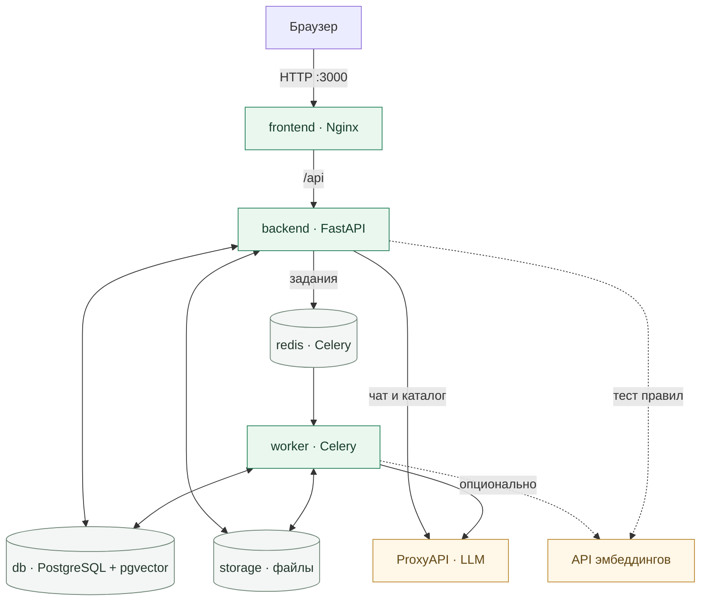

<p align="center">
  
</p>

<h1 align="center">AntiRisk</h1>

<p align="center">
  <strong>От закупочной документации — к замечаниям с цитатами и готовому отчёту.</strong><br>
  Проверка документов по настраиваемым правилам для закупок по 44-ФЗ и 223-ФЗ.
</p>

<p align="center">
  <a href="frontend/package.json"></a>
  <a href="backend/requirements.txt"></a>
  <a href="docker-compose.yml"></a>
  <a href="docker-compose.yml"></a>
</p>

<p align="center">
  <a href="#быстрый-старт">Быстрый старт</a> ·
  <a href="#архитектура">Архитектура</a> ·
  <a href="#модели-и-режимы">Модели</a> ·
  <a href="#настройка">Настройка</a> ·
  <a href="#разработка">Разработка</a>
</p>

---

## Возможности

| Задача | Что доступно |
|---|---|
| Собрать документы | Проекты, загрузка отдельных файлов и ZIP, переименование и удаление |
| Подготовить текст | Конвертация в PDF, OCR сканов на русском и английском, оглавление и поиск |
| Найти условия | Гибридный поиск по фрагментам документа: pgvector и полнотекстовый поиск PostgreSQL |
| Проверить правила | LLM через ProxyAPI или поиск по ключевым словам; выбор модели и чувствительности |
| Рассмотреть замечания | Цитата, пункт, страница, подсветка, обоснование, рекомендация и решение пользователя |
| Подготовить результат | Отчёты DOCX/PDF/CSV/JSON, протокол разногласий и чат по обработанному документу |

**Форматы:** PDF, DOCX, DOC, RTF, ODT, TXT, PNG, JPG/JPEG, TIF/TIFF, BMP и ZIP.
Лимит одного загружаемого файла — **100 МБ**.

## Быстрый старт

Нужны **Git** и **Docker с Compose v2**. Для первой сборки требуется доступ к сети.
Python, Node.js, Tesseract и LibreOffice устанавливаются внутри образов.

### 1. Подготовьте проект

```bash
git clone --branch develop https://github.com/illusion376/B2B-AntiRisk.git
cd B2B-AntiRisk
cp .env.example .env
```

В PowerShell используйте `Copy-Item .env.example .env` вместо `cp`.

### 2. Настройте подключение

В корневом `.env` задайте ключ ProxyAPI. Для первого запуска удобно использовать
локальные хэш-эмбеддинги — оставьте оба параметра эмбеддингов пустыми:

```dotenv
ANALYSIS_ENGINE=auto
LLM_BASE_URL=https://api.proxyapi.ru/v1
LLM_API_KEY=your-proxyapi-key
LLM_MAX_TOKENS=8192

EMBEDDING_BASE_URL=
EMBEDDING_API_KEY=
```

Замените `your-proxyapi-key` действующим ключом. **Модель анализа выбирается в селекторе интерфейса;
в `.env` её указывать не нужно.**

В `.env.example` адрес внешних эмбеддингов уже заполнен. Для варианта выше его нужно очистить.
Если оставить также `LLM_API_KEY` пустым, режим `auto` выберет поиск по ключевым словам.

### 3. Запустите приложение

```bash
docker compose up -d --build
```

| Адрес | Назначение |
|---|---|
| [localhost:3000](http://localhost:3000) | Интерфейс приложения |
| [localhost:8000/docs](http://localhost:8000/docs) | Swagger с актуальными маршрутами и схемами API |
| [localhost:3000/api/health](http://localhost:3000/api/health) | Проверка соединения API с БД и Redis |

### 4. Выполните первую проверку

1. Создайте проект и загрузите документы.
2. В **«Настройках»** выберите режим анализа, модель и чувствительность.
3. Нажмите **«Начать анализ»** в проекте. Загрузка сама по себе не запускает проверку.
4. Откройте обработанный документ, рассмотрите замечания и скачайте отчёт.

Режим, модель и чувствительность сохраняются на сервере при запуске задачи.
Следующее изменение настроек применяется к новым запускам.

## Архитектура

Приложение состоит из **пяти сервисов Docker Compose**. Frontend собирается в статические
файлы Next.js и раздаётся Nginx. Запросы `/api` проксируются в FastAPI на том же адресе.



- **FastAPI** принимает файлы, управляет проектами и правилами, отдаёт результаты, формирует отчёты и обслуживает чат.
- **Celery worker** конвертирует документы, выполняет OCR, строит индекс и запускает проверку правил.
- **PostgreSQL + pgvector** хранит метаданные, текст, векторы, замечания, решения и историю чата.
- **Redis** используется как брокер заданий и backend результатов Celery.
- **Том `storage`** общий для API и worker: исходники, распакованные файлы, PDF и отчёты.

Ключи провайдера остаются на сервере. Интерфейс получает каталог моделей и результаты через API.
При пустом `EMBEDDING_BASE_URL` векторы вычисляются локально без загрузки весов и без GPU.

Подробнее: **[архитектура и путь документа](docs/architecture.md)**.

## Модели и режимы

Текущий набор селектора задан в [`FEATURED`](backend/app/services/analysis_models.py):

| Модель | Идентификатор ProxyAPI |
|---|---|
| GPT-6 Luna | `openai/gpt-6-luna` |
| Claude Haiku 5.5 | `anthropic/claude-haiku-5-5` |
| DeepSeek V4 Flash | `deepseek/deepseek-v4-flash` |

Каталог доступности запрашивает backend. При ошибке обновления интерфейс показывает основной
набор с предупреждением. Наличие модели в каталоге не подтверждает баланс и доступ к генерации.

| Режим | Как работает |
|---|---|
| `llm` | Проверяет отобранные фрагменты языковой моделью через ProxyAPI |
| `keyword` | Находит фрагменты по словам для дальнейшего рассмотрения |
| `auto` | Серверный выбор по умолчанию: LLM при настроенном подключении, иначе `keyword` |

Локальный режим `nli` отключён. Выбор модели в селекторе относится к анализу документов;
ИИ-помощник сейчас использует встроенную серверную модель по умолчанию.

## Результаты и отчёты

У замечания есть уровень риска и отдельный статус рассмотрения:
**«Не просмотрено»**, **«Принято»** или **«Отклонено»**.

| Уровень | Значение | Влияние на итог |
|---|---|---|
| `RED` | Критическое замечание | 🔴 Красный статус |
| `YELLOW` | Требует внимания | 🟡 Жёлтый статус |
| `LOW` | Низкий риск | 🟡 Жёлтый статус |
| `GREEN` | Без замечаний по правилу | Не повышает риск |
| `UNKNOWN` | Недостаточно данных | Неполная оценка, индекс не вычисляется |

**Зелёный итоговый статус означает отсутствие активных рисков после завершённой проверки.**
Одно `LOW` даёт индекс **3** и жёлтый итоговый статус. Отклонённые замечания не повышают риск.
Если наряду с неполной оценкой есть подтверждённый риск, итог сохраняет его красный или жёлтый цвет,
а индекс остаётся неопределённым. Без результатов зелёный статус не выставляется.

Сервер рассчитывает индекс по нелинейной шкале 0–100.
Для ZIP с несколькими документами берётся максимальный индекс документов, а не их сумма.
Логика находится в [scoring.py](backend/app/services/scoring.py).

| Отчёт | Форматы |
|---|---|
| Краткий | DOCX, PDF, CSV, JSON |
| Подробный | DOCX, PDF, CSV, JSON |
| Протокол разногласий | DOCX, PDF, JSON |
| Документ с пометками | PDF |

Имя и компания автора задаются в **«Настройки → Данные для отчёта»**.
PDF с пометками формируется для одного документа и недоступен при активных результатах неполной проверки.

ИИ-помощник отвечает по текущему документу, результатам проверки и истории диалога.
Он может подготовить черновик отчёта или протокола для скачивания в Word.

## Настройка

Основные параметры задаются в корневом `.env`; Docker Compose передаёт их backend и worker.
Полный список настроек: [config.py](backend/app/config.py).
Фактическое окружение контейнеров: [docker-compose.yml](docker-compose.yml).

| Параметры | Назначение |
|---|---|
| `LLM_BASE_URL`, `LLM_API_KEY` | Адрес ProxyAPI и ключ для анализа и помощника |
| `LLM_MAX_TOKENS` | Лимит ответа; в `.env.example` задано `8192` |
| `LLM_CONCURRENCY`, `LLM_TIMEOUT_S` | Параллельные LLM-запросы и таймаут; по умолчанию 6 и 120 секунд |
| `EMBEDDING_BASE_URL`, `EMBEDDING_API_KEY`, `EMBEDDING_MODEL` | Отдельное подключение к внешнему API эмбеддингов |
| `EMBEDDING_SEND_DIMENSIONS` | Передавать параметр размерности, если endpoint его поддерживает |
| `RETRIEVAL_TOP_K`, `RETRIEVAL_MAX_DISTANCE` | Число фрагментов на правило и порог векторного поиска; по умолчанию 4 и 0.58 |
| `OCR_THREADS`, `WORKER_CONCURRENCY` | Потоки OCR на документ и число процессов worker; по умолчанию 4 и 2 |
| `ANALYSIS_ENGINE`, `HEURISTIC_ENGINE` | Серверный режим по умолчанию и режим поиска без LLM |
| `CORS_ORIGINS` | Разрешённые origin при обращении к API с другого адреса |

Оставьте `LLM_MAX_TOKENS=8192` явно: резервное значение в Compose без этой переменной — `1500`.
Ключи не должны попадать в переменные `NEXT_PUBLIC_*`.

<details>
<summary><strong>Подключение внешних эмбеддингов</strong></summary>

Вместо локального хэширования можно подключить OpenAI-совместимый endpoint `/embeddings`:

```dotenv
EMBEDDING_BASE_URL=https://api.proxyapi.ru/v1
EMBEDDING_API_KEY=your-embedding-key
EMBEDDING_MODEL=baai/bge-m3
EMBEDDING_SEND_DIMENSIONS=false
```

Укажите модель, доступную выбранному endpoint. Схема БД ожидает векторы размерности **1024**.
Параметр `dimensions` отправляется только при `EMBEDDING_SEND_DIMENSIONS=true`.

Ключ эмбеддингов заполняется отдельно: `LLM_API_KEY` автоматически не подставляется.
При использовании одного аккаунта ProxyAPI один и тот же действующий ключ можно записать в оба параметра.

</details>

После изменения `.env` пересоздайте оба сервиса:

```bash
docker compose up -d --force-recreate backend worker
```

В Compose адреса БД, Redis и путь к файлам заданы для внутренней сети контейнеров.
`DATABASE_URL`, `REDIS_URL` и `STORAGE_DIR` из примера нужны при локальном запуске Python вне Docker.

## Разработка

**Backend:** Python 3.12. **Frontend:** Node.js 20.9+; в Docker используется Node.js 22.

Backend-проверки выполняются из виртуального окружения:

```bash
python -m venv .venv
source .venv/bin/activate
python -m pip install -r backend/requirements-dev.txt
cd backend
python -m pytest -q
```

В PowerShell активация окружения: `.\.venv\Scripts\Activate.ps1`.

Frontend:

```bash
cd frontend
npm ci
npm test
npm run typecheck
npm run build
```

Для dev-сервера используйте `npm run dev`. Настройка прокси и портов описана в
[frontend/README.md](frontend/README.md).

Сквозной smoke для уже запущенного стека запускается **из корня репозитория**:

```bash
python backend/tests/smoke.py
```

Он создаёт тестовые данные, загружает документы и проверяет обработку, поиск, замечания и отчёты
в настроенном на сервере режиме анализа.

## Структура репозитория

| Путь | Содержимое |
|---|---|
| [frontend/app](frontend/app) | Страница приложения, layout и общие стили |
| [frontend/components](frontend/components) | Проекты, документы, селектор моделей, правила, настройки и чат |
| [frontend/lib](frontend/lib) | API-клиент, типы, навигация и настройки браузера |
| [backend/app/api](backend/app/api) | Маршруты FastAPI |
| [backend/app/services](backend/app/services) | Обработка файлов, поиск, анализ, чат и экспорт |
| [backend/tests](backend/tests) | Модульные и API-тесты, сквозной smoke |
| [database](database) | Базовая схема PostgreSQL и SQL-миграции |
| [docs/architecture.md](docs/architecture.md) | Связи сервисов, обработка документа и модель данных |

## Эксплуатация и диагностика

```bash
docker compose ps
docker compose logs --tail=100 backend worker
docker compose up -d --build
```

Базовая схема создаётся при первом запуске PostgreSQL. Backend применяет SQL-миграции
при старте, worker ожидает его готовности. Данные БД хранятся в томе `pgdata`,
файлы — в томе `storage`.

| Симптом | Что проверить |
|---|---|
| `Embeddings API 401` | Отдельный `EMBEDDING_API_KEY`; для локальных эмбеддингов очистите `EMBEDDING_BASE_URL` |
| Ошибка LLM или модели | Ключ, URL, доступ провайдера и выбранную модель; обновите каталог в селекторе |
| Несовместимая размерность | Выход модели эмбеддингов должен содержать 1024 значения |
| Задача остаётся в очереди | Состояние Redis, worker и логи backend/worker |
| Не хватает лимита ответа | `LLM_MAX_TOKENS` в `.env` и пересоздание backend/worker |

## Границы текущей версии

- Анализ опирается на фрагменты, отобранные под правила. Ненайденное условие не считается подтверждённым отсутствием риска.
- Результаты `UNKNOWN` сохраняются в API и подробных отчётах, но скрыты в списке замечаний интерфейса.
- Поиск по словам предназначен для рассмотрения найденных фрагментов пользователем.
- Идентификация использует `X-User-Id` или демонстрационный профиль. Полноценный вход и аутентификация пока не реализованы; текущий Compose предназначен для разработки и демонстрации.
