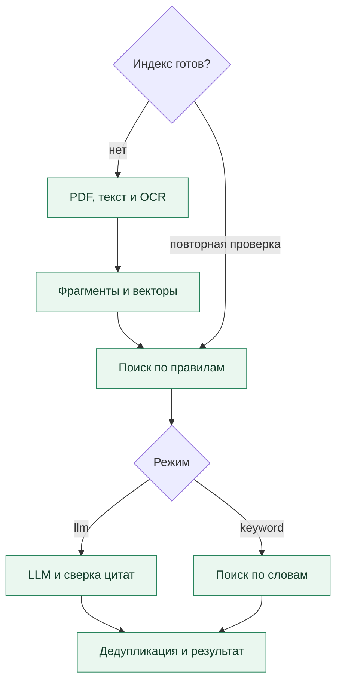

# Архитектура AntiRisk

[← Основной README](../README.md#архитектура)

AntiRisk разделяет HTTP-запросы и длительную обработку документов.
API и worker используют один Python-код, общую БД и файловый том, но работают в отдельных контейнерах.
Схема связей сервисов приведена в [основном README](../README.md#архитектура).

## Компоненты и ответственность

| Компонент | Реализация | Ответственность |
|---|---|---|
| Интерфейс | Next.js 16, React 19, TypeScript | Проекты, просмотр документа, замечания, правила, настройки и чат |
| Web-сервер | Nginx, сервис `frontend` | Статический каталог `out/` и прокси `/api/` в backend |
| API | FastAPI, SQLAlchemy, сервис `backend` | Загрузка, запуск задач, чтение результатов, отчёты, чат и миграции |
| Очередь | Redis 7 | Брокер заданий и хранение результатов Celery |
| Обработка | Celery 5, сервис `worker` | Конвертация, OCR, индексация и проверка правил |
| Данные | PostgreSQL 16, pgvector | Метаданные, страницы, фрагменты, векторы и результаты |
| Файлы | Общий том `storage` | Исходники, распакованные документы, PDF и отчёты |
| LLM | ProxyAPI | Каталог моделей, анализ условий и ответы помощника |
| Эмбеддинги | Локальное хэширование или внешний API | Векторное представление фрагментов и поисковых запросов правил |

В production-сборке у frontend нет работающего сервера Next.js: Node.js используется на этапе сборки.
В разработке `npm run dev` запускает Next.js с прокси на API.

## Путь документа

Проект объединяет загруженные файлы. Каждая загрузка создаёт сущность `Analysis`;
обычный файл содержит один `Document`, ZIP — несколько.

Загрузка через проект сохраняет файлы со статусом `UPLOADED`.
Кнопка запуска фиксирует режим, модель и чувствительность у документов, коммитит изменения в БД
и ставит задачи в Celery. Низкоуровневый `POST /api/analyses` загружает файл
и сразу запускает обработку.

1. **Подготовка.** LibreOffice приводит офисные форматы к PDF; изображения также превращаются в PDF.
2. **Текст.** PyMuPDF извлекает текст и координаты слов, Tesseract распознаёт страницы с недостаточным текстовым слоем.
3. **Индекс.** Текст делится на фрагменты со страницами и заголовками; векторы сохраняются в `document_chunks`.
4. **Поиск.** Для каждого активного правила объединяются векторный и русский полнотекстовый поиск.
   Результаты сливаются через RRF, затем MMR отбирает разнообразные фрагменты.
5. **Проверка.** LLM получает найденные фрагменты и правило. Цитаты ответа сверяются с извлечённым текстом;
   при недостаточных основаниях сохраняется неполная оценка. В режиме `keyword` используется поиск по словам.
6. **Сохранение.** Дубли объединяются, замечания нумеруются, документ получает итоговый статус и индекс риска.

Повторная проверка успешно обработанного документа использует сохранённые текст и индекс.
Режим, модель и чувствительность берутся из документа, а не из изменившихся настроек интерфейса.

## Хранение данных

| Сущность | Что хранит |
|---|---|
| `Project` | Название проекта и связь с загрузками |
| `Analysis` | Исходную загрузку, ZIP или отдельный файл, общий прогресс |
| `Document` | Документ, путь к PDF, выбранные параметры и результат обработки |
| `DocumentPage` | Текст страницы, координаты слов и сведения об OCR |
| `DocumentChunk` | Фрагмент текста, диапазон страниц и вектор размерности 1024 |
| `RiskRule` | Правило, уровень риска, поисковый запрос, prompt и кэш вектора запроса |
| `RiskFinding` | Замечание, цитату, подсветку, рекомендацию и решение пользователя |
| `DocumentChatMessage` | Историю диалога, источники и подготовленный черновик |
| `User`, `AuditLog` | Профиль автора и историю действий |

Правила общие: у `RiskRule` нет связи с отдельным проектом.
Выключенные правила скрывают связанные замечания из актуальных ответов API и отчётов.
Отклонённые замечания сохраняются, но исключаются из оценки риска.

Файлы размещаются внутри `storage/<analysis_id>/` в каталогах `upload`, `files`, `preview` и `reports`.
Базовая SQL-схема и миграции лежат в [database](../database);
применённые миграции учитываются в `schema_migrations`.

## Результаты, отчёты и помощник

Расчёт светофора общий для API и отчётов: `RED` имеет наивысший приоритет,
`YELLOW` даёт жёлтый итог, а `LOW` допускает зелёный при полной проверке без `RED` и `YELLOW`.
`UNKNOWN` не превращается в зелёный и оставляет числовой индекс неопределённым.
API дополнительно проверяет, что обработка завершена и результаты существуют.

Отчёты формируются в API по текущим видимым замечаниям и решениям пользователя.
DOCX создаётся через python-docx, PDF-отчёты конвертируются LibreOffice;
для пометок в исходном PDF используется PyMuPDF.

Чат также обслуживается API. Его контекст собирается из текущего документа, замечаний,
итоговых данных отчёта и серверной истории с ограничением объёма.
Ответ проверяется по схеме и допустимым источникам. Черновики помощника скачиваются как DOCX;
модель помощника берётся из `Document.llm_model` — та же, что использовалась для проверки документа.
При повторной проверке с другой моделью помощник использует новое значение. Если модель
в документе не сохранена (например, при проверке по словам), используется серверное значение по умолчанию.

## Обновление интерфейса и границы интеграций

- Интерфейс опрашивает API каждые 2,5 секунды, пока есть документы в очереди или обработке.
  В API также есть SSE-маршрут `/api/analyses/{id}/events`; текущие React-хуки используют опрос.
- Предпочтения модели, режима и интерфейса хранятся в браузере. Выбранные параметры конкретного запуска,
  замечания, решения, профиль и история чата сохраняются на сервере.
- LLM-запросы и каталог моделей идут через backend/worker. При внешних эмбеддингах текстовые фрагменты
  дополнительно передаются настроенному endpoint; локальное хэширование работает внутри приложения.
- В браузер не передаются ключи LLM и эмбеддингов.
- Локальная NLI-модель отключена; наличие старых полей конфигурации не означает доступность этого режима.

## Где искать реализацию

| Область | Исходники |
|---|---|
| Топология и окружение | [docker-compose.yml](../docker-compose.yml), [config.py](../backend/app/config.py) |
| Маршруты и модели | [api](../backend/app/api), [models.py](../backend/app/models.py), [schemas.py](../backend/app/schemas.py) |
| Загрузка и очередь | [uploads.py](../backend/app/services/uploads.py), [analyses.py](../backend/app/api/analyses.py), [tasks.py](../backend/app/tasks.py) |
| Пайплайн, OCR и поиск | [pipeline.py](../backend/app/services/pipeline.py), [extraction.py](../backend/app/services/extraction.py), [retrieval.py](../backend/app/services/retrieval.py) |
| Модели и LLM | [analysis_models.py](../backend/app/services/analysis_models.py), [llm.py](../backend/app/services/llm.py), [analyzer.py](../backend/app/services/analyzer.py) |
| Итог и экспорт | [scoring.py](../backend/app/services/scoring.py), [reports](../backend/app/services/reports) |
| Помощник | [chat.py](../backend/app/api/chat.py), [document_chat.py](../backend/app/services/document_chat.py) |
| Состояние интерфейса | [use-workspace-data.ts](../frontend/components/use-workspace-data.ts), [use-analysis-models.ts](../frontend/components/use-analysis-models.ts) |
